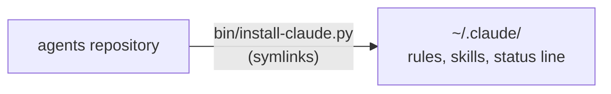

# How it works

The repository's consumer is Claude Code on your machine, which reads the rules and skills from
`~/.claude/`. The checker that enforces the mechanical rules in each project's pre-commit and CI is in
the auditor repository (`bnomis/auditor`, <https://bnomis.github.io/auditor/>).

## Rules and skills in `~/.claude/`

`bin/install-claude.py` links `claude/` into `~/.claude/` one level down: a file such as
`claude/CLAUDE.md` becomes a symlink, and a directory such as `claude/skills/` becomes a real directory
whose entries are symlinks, so skills and rules of your own in `~/.claude/` sit beside the shared ones.
A file already at a link's place is renamed with an `.orig` suffix, never overwritten. Because the
links point back into your clone, a `git pull` updates every session at once; only a new top-level
entry (a new skill or rule) needs the installer run again.

- **Rules** (`claude/rules/`) are Markdown files Claude Code loads as instructions. A rule with a
  `paths:` list in its front matter loads only when the session works on matching files.
- **Skills** (`claude/skills/<name>/SKILL.md`) are invoked as `/<name>`, or picked up by Claude when a
  request matches the skill's description.
- **`claude/CLAUDE.md`** holds the working agreement loaded in every session: plan first, verify
  before calling work done, turn each correction into a rule.

These files are shared by every project, so none of them names one. A project's own rules and skills
live in its own `claude/` directory, loaded from that project's `CLAUDE.md`.

## Records in a repository

The skills keep their records in the repository they work on:

| Path | Written by | Holds |
|---|---|---|
| `agents/specs/<slug>/spec.md` | `/specdev` | a spec, with its version, status and amendments |
| `agents/tasks/<slug>/tasks-N.md` | `/taskdev` | a task list for a spec, run task by task |
| `agents/tasks/order-<slug>.md` | `/todo-run-order` | a run order of task lists, run by `/rro` |
| `TODO.md` | `/todo-add`, `/todo-review`, `/todo-do` | open work only, in implementation order |
| `DONE.md` | `/todo-do`, `/todo-review` | finished items, unchanged, each with a `Done:` line |

See [Skills](reference/skills.md) for each skill's inputs and outputs.
