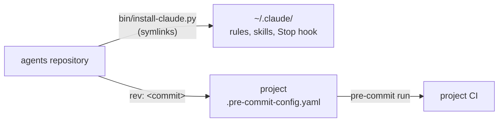

# How it works

The repository has two consumers: Claude Code on your machine, which reads the rules and skills from
`~/.claude/`, and each project's pre-commit and CI, which run the checker pinned to a commit of this
repository.



## Rules and skills in `~/.claude/`

`bin/install-claude.py` links `claude/` into `~/.claude/` one level down: a file such as
`claude/CLAUDE.md` becomes a symlink, and a directory such as `claude/skills/` becomes a real directory
whose entries are symlinks, so skills and rules of your own in `~/.claude/` sit beside the shared ones.
A file already at a link's place is renamed with an `.orig` suffix, never overwritten. Because the
links point back into your clone, a `git pull` updates every session at once; only a new top-level
entry (a new skill or rule) needs the installer run again.

- **Rules** (`claude/rules/`) are Markdown files Claude Code loads as instructions. A rule with a
  `paths:` list in its front matter loads only when the session works on matching files.
- **Skills** (`claude/skills/<name>/SKILL.md`) are invoked as `/<name>`, or picked up by Claude when a
  request matches the skill's description.
- **`claude/CLAUDE.md`** holds the working agreement loaded in every session: plan first, verify
  before calling work done, turn each correction into a rule.

These files are shared by every project, so none of them names one. A project's own rules and skills
live in its own `claude/` directory, loaded from that project's `CLAUDE.md`.

## The checker in a project

The checker is `claude/skills/auditme/checks/`: a Python script with no dependencies outside the
standard library, plus `ruff` and `uv` for the hygiene checks. A project pins it through
`.pre-commit-hooks.yaml`:

| Where | Hook | Scope | Fails on |
|---|---|---|---|
| `git commit` | `auditme-changed` | the whole tree is swept, hits are reported for changed files only | an unaccepted hit in a file the commit changes, or in a file a cross-file hit links to one |
| `git push` | `auditme-all` | the whole tree | any unaccepted hit |
| CI | `auditme-all` | the whole tree | any unaccepted hit |

The commit hook ignores hits in files you did not touch, so an old hit never blocks an unrelated
commit. The push gate and CI catch what the commit hook cannot see: a hit that appears without its
file changing, such as a duplicate of code added elsewhere.

A hit you have judged correct to keep is accepted in the code, beside the hit, with the reason:

```python
# auditme: accept[<rule>] <reason>
```

The reason stays in the source, where the next reader of that line sees it. See
[The audit checker](guide/checker.md) for the rules and the marker's exact placement.

## Pinning and upgrades

Projects pin the hooks with `rev:` to a commit of this repository. A new rule therefore fails no build
until a project upgrades with `pre-commit autoupdate`, and the upgrade commit fixes or accepts the new
hits in the same change. This repository runs its own hooks from its working tree (`repo: local`), so a
checker change applies in the commit that makes it.

## The Stop hook

`bin/install-claude.py` also registers `claude/hooks/auditme-stop.sh` as a Claude Code Stop hook in
`~/.claude/settings.json`. In a project whose `.pre-commit-config.yaml` contains `id: auditme-changed`,
it runs the checker over the changed files when Claude ends a turn, and sends the hits back once, so
Claude fixes them before handing over. Elsewhere it does nothing.

The Stop hook runs the checker from your clone, not the project's pinned revision, so it is an early
warning; the pinned hooks remain the authority.

## Records in a repository

The skills keep their records in the repository they work on:

| Path | Written by | Holds |
|---|---|---|
| `agents/specs/<slug>/spec.md` | `/specdev` | a spec, with its version, status and amendments |
| `agents/tasks/<slug>/tasks-N.md` | `/taskdev` | a task list for a spec, run task by task |
| `TODO.md` | `/todo-add`, `/todo-review`, `/todo-do` | open work only, in implementation order |
| `DONE.md` | `/todo-do`, `/todo-review` | finished items, unchanged, each with a `Done:` line |

See [Skills](reference/skills.md) for each skill's inputs and outputs.
